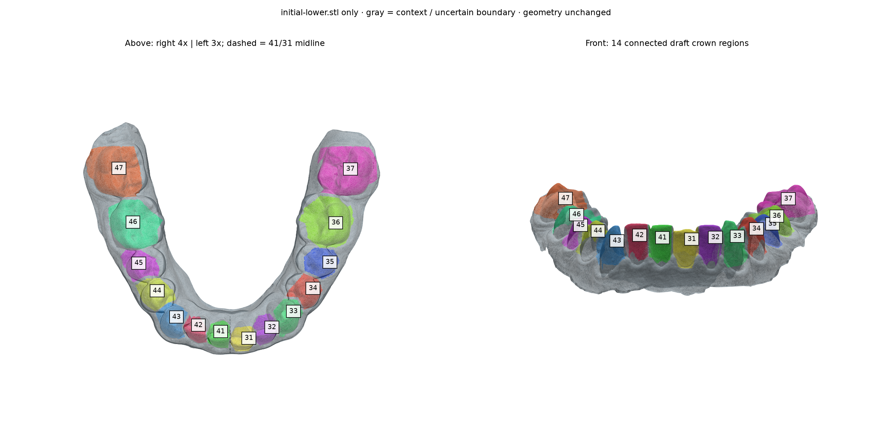

# USER_ONE lower baseline — segmentation draft

Only initial-lower.stl was processed; original scan geometry is unchanged.
Exactly 14 labels, one manifold-edge-connected component per tooth; 38/48 absent.
Contact buffers, overlapping outlines, discarded fragments and context remain unlabeled.



## Width and boundary uncertainty

98th minus 2nd percentile of source vertices projected onto the local arch tangent between neighboring crown seeds; not clinical mesiodistal caliper width.
Units use the case's declared mm scale. Bounds are conservative crown-mask estimates;
anatomical gumlines, hidden contact surfaces and scale need review. No width-based resizing was applied.

| FDI | Faces | Components | Estimated width (mm) | Supplied range (mm) | Check |
| --- | ---: | ---: | ---: | --- | --- |
| 47 | 13,868 | 1 | 11.37 | [10, 10.5] | Outside supplied range; inspect extent/rotation |
| 46 | 11,775 | 1 | 10.31 | [10.5, 11.5] | Outside supplied range; inspect extent/rotation |
| 45 | 7,309 | 1 | 6.48 | [7, 7.5] | Outside supplied range; inspect extent/rotation |
| 44 | 7,568 | 1 | 6.70 | [7, 7.5] | Outside supplied range; inspect extent/rotation |
| 43 | 10,063 | 1 | 7.13 | [6.5, 7] | Outside supplied range; inspect extent/rotation |
| 42 | 5,700 | 1 | 5.25 | [5.5, 6] | Outside supplied range; inspect extent/rotation |
| 41 | 6,982 | 1 | 4.79 | [5, 5.5] | Outside supplied range; inspect extent/rotation |
| 31 | 8,091 | 1 | 5.11 | [5, 5.5] | Within supplied range; draft |
| 32 | 6,455 | 1 | 5.23 | [5.5, 6] | Outside supplied range; inspect extent/rotation |
| 33 | 8,197 | 1 | 7.04 | [6.5, 7] | Outside supplied range; inspect extent/rotation |
| 34 | 7,161 | 1 | 6.40 | [7, 7.5] | Outside supplied range; inspect extent/rotation |
| 35 | 7,149 | 1 | 6.08 | [7, 7.5] | Outside supplied range; inspect extent/rotation |
| 36 | 11,543 | 1 | 10.12 | [10.5, 11.5] | Outside supplied range; inspect extent/rotation |
| 37 | 16,107 | 1 | 10.90 | [10, 10.5] | Outside supplied range; inspect extent/rotation |

## Midline and side convention

Above-view inspection places the 41/31 inter-incisor contact near original X=0, Y=-45.5. Separate anterior seeds lie on either side and proceed outward 41/42/43 and 31/32/33. Patient right/left retains the existing lower case convention (negative X=4x, positive X=3x); an unmarked mesh alone does not independently establish anatomical handedness.

The mirrored numbering order does not imply symmetric tooth positions or shapes.

## Reproduce

```bash
python3 tools/correct_user_one_lower_labels.py
```

Recipe polygons follow estimated valleys/contact lines in the lower-only occlusal view.
Every triangle corner must lie inside one outline and the previous crown mask.
Contested faces and faces bridging labels are cleared. Only the largest connected
component of each candidate remains. Connectivity is verified; anatomical precision is not.
