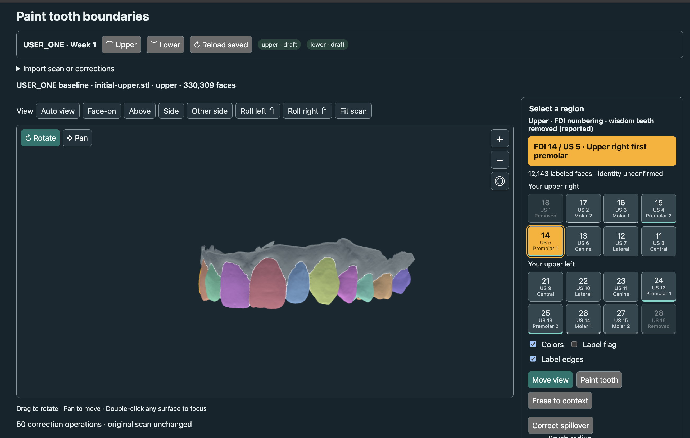

# Correcting tooth regions

Open **Edit Tooth Precision** in the app sidebar or in Guided **step 2: Teeth
& time**, after loading scans and before building movement stages. Scan history
also links directly to USER_ONE week 1, week 7 and week 18 upper/lower scans. **Edit tooth boundaries** under
an uploaded scan brings that surface into the editor. The direct URL is
`/region-review.html`. This is a scan-labeling task, not an aligner stage; for
USER_ONE, choose week 1, week 7 or week 18 with separate upper and lower annotations.
Load the sample baseline or your own STL, then optionally import its correction
JSON. Choose **Move view** to navigate; **Paint tooth** paints the chosen tooth number;
Split only paints faces belonging to the From tooth; Merge changes the complete
From region to the To tooth; Erase returns faces to context. Brush selection uses
surface position and normal agreement to avoid painting the opposite surface.
Undo/redo keeps up to 50 edit operations; each continuous brush drag is one operation. Download corrections JSON exports face-order
labels bound to the source SHA-256; applying to another scan is rejected.

Personal scans can also **Save locally**: original bytes, painted labels and notes
are saved in this browser, keyed by scan content hash and arch. Reopening the same
scan resumes its draft. A stale editor cannot overwrite a newer save from another
tab; reopen the scan to load that revision. Browser data can be cleared or evicted.
The separate **Download JSON** exports labels only, so retain notes separately
when moving work to another browser. Sample saves still use versioned local files.

To read notes again, choose **Saved painting notes** in the main sidebar. It lists
the latest saved notes for each personal scan and each USER_ONE visit/arch, with
the save date and storage location. **Open painting & notes** reopens that exact
scan; **Back to saved notes** returns to the refreshed list. Unsaved text appears
there only after **Save locally** succeeds. **Refresh saved notes** picks up saves
made in another tab or editor.

Explicitly checking the review checkbox records the user's boundary review.
It does not approve fitted motion or anatomy. The fitting engine can consume
corrections for either endpoint and preserves their supplied crown masks rather
than cropping them again. Existing automatic segmentation remains a fallback.

To compare a stronger installed segmentation plug-in against the hybrid baseline,
use the existing `orthoplan segmentation-benchmark --manifest <reviewed-corpus>`
workflow described in `segmentation-learned-backend.md`. No new model weights or
reviewed corpus have been supplied in this change, so no superiority score is
claimed. The independent motion scorer in `MOTION_BENCHMARK.md` complements that
boundary benchmark with correspondence and pose errors.

## Painting example

USER_ONE's **week 1 upper baseline** during label editing. Colors separate tooth
labels; gray is unlabeled/context. Select a tooth number, paint its crown, rotate
to inspect hidden surfaces, then **Save locally**. This screenshot is an editing
example; the versioned annotation files hold the saved labels.

## A first contributor review session

With `orthoplan serve` running, open
[Review tooth regions](http://127.0.0.1:8000/region-review.html).
Start with a few clearly visible teeth, rather than marking an entire arch as
reviewed at once.

1. Choose **Upper** or **Lower**. The editor
   restores the latest local save for that arch, or starts with colored draft
   labels if none exists. It never silently defaults to an upper scan. Changing
   the arch selector while editing a baseline loads the matching baseline and
   numbers; an unsaved-work prompt protects edits before replacing the scan. For a week 18 capture, set **Lower**
   first and choose its local STL through **Import scan or corrections → Own STL**, or use **Edit tooth boundaries**
   from the main uploaded-scan viewer. A filename containing an unambiguous lower/upper
   arch label sets the import arch. A newly loaded own scan
   starts gray/unlabeled; import matching correction JSON if available. Private
   files do not need to be added to the public catalog or asset allowlist.
2. Use **Auto view** to fit the scan, then **Face-on**, **Above**, **Side**,
   **Other side**, or **Roll left/right** to choose an angle. **Move view** enables
   drag-to-rotate, scroll/pinch-to-zoom, and right-drag-to-pan. Auto view uses the
   thin bounding-box axis as a starting estimate, not a verified anatomical frame.
   These controls change only the camera; original face order, coordinates,
   source hashes, and fitted poses stay unchanged. **Fit scan** preserves the
   current angle and fits the whole scan. Viewer-edge **+ / −** buttons
   change camera distance without changing labels.
   Establish orientation and tooth numbering before painting. The numbered buttons
   use FDI, offer tooth names, and follow the loaded arch. Uncertain identities
   need notes, not guesses made to complete the labels.
3. Click a numbered tooth button. Its name, FDI number and US Universal equivalent appear beside the scan.
   The palette also shows small US numbers beneath each FDI number. Existing faces for that label turn amber with a numbered location
   marker, while other labels retain their colors by default. **◎ Focus selected region** centers
   and fits its region. Double-click a labeled crown in Move view for the same
   action. After focusing, view presets (including Other side) orbit/frame that
   region, so its inside remains accessible. **Fit scan** or **Auto view** returns
   to whole-arch framing. These are draft
   label locations, not confirmed tooth identities. In **Move view**, clicking
   a labeled surface selects its number without painting. **Colors** is on by default; turn it off to mute other regions. **Label flag** is off by default; turn it on to show the numbered marker.
   If no faces carry a number, the editor says there is nothing to highlight;
   use the location guide and confirm which crown it is before painting. A tooth
   number alone cannot locate an unpainted or missing tooth.
   Choose **Paint tooth** and drag over its visible crown surface. The brush ring
   updates immediately from keyboard shortcuts, buttons and numeric input, even
   without moving the pointer. Press **[** to decrease or **]** to increase it by 0.1 scan
   units, bounded to 0.1–10; matching buttons sit beside the radius field. These
   shortcuts do not intercept typing in text, numeric or dropdown fields.
   The instruction panel names the active tooth and reports its labeled face count.
   Use a smaller radius near tooth/gum transitions and neighboring teeth. This
   paints mesh faces; drawing only an outline does not fill the enclosed crown.
   Rotate and check both sides. The position/normal filter reduces accidental
   opposite-surface painting but does not guarantee correct anatomical boundaries.
4. Use **Erase to context** to remove gum or extra surface from a tooth label;
   **Split selected source** transfers only the From region under the brush.
   **Merge from → to** changes the entire source region. Split, numeric From/To,
   and merge controls are under **Split / merge labels**. Undo mistakes promptly.
   Mark uncertain boundaries and model defects in accompanying notes/view images;
   the current editor has no dedicated uncertainty or defect layer.
5. For USER_ONE baselines, use **Save locally** frequently. Partial work keeps
   **I checked all tooth boundaries and numbers on this scan** unchecked. Add
   uncertainties, missing tooth identities and chip observations under **Notes & saved file**.
   When the entire arch has been checked, check the review box and save again.
   Each save creates an immutable timestamped JSON snapshot under
   `.orthoplan-region-corrections/USER_ONE/baseline-upper/` or `baseline-lower/`.
   The UI displays the exact local path and separate saved status for each arch.
   These files survive browser/server restarts and remain outside Git by default.
   `ORTHOPLAN_REGION_CORRECTIONS` can select another local storage directory.
6. Load the same baseline to resume its latest snapshot, including notes and
   review status. **Download JSON** gives a portable face-label
   record for any scan; use **Load saved correction JSON** with the identical
   scan to import it. Local snapshots also preserve source identity, notes,
   timestamp and review status; neither save format preserves undo history.
   Server saves validate source hash, face count and arch-specific FDI IDs before
   writing. A failed save is shown explicitly. Existing snapshots are retained.
7. When upper and lower are complete and saved, tell the collaborator **both
   baselines are saved**. They can inspect the local files, validate source
   binding and boundary quality, then incorporate approved annotation versions
   into the private dataset and regenerate comparisons deliberately. Saving
   alone does not replace bundled motion previews, refit endpoints, train a
   model or establish benchmark ground truth. The assistant can inspect saved
   artifacts but does not receive unsaved pointer movements or brush edits.

FDI numbering distinguishes arches: **11–18** upper right, **21–28** upper left,
**31–38** lower left, and **41–48** lower right. For example, 18 is an upper right
third-molar position. Only numbers for the loaded arch appear. These are possible
positions, not evidence that every tooth is present or correctly identified in
the draft labels. Do not paint a missing tooth merely because it has a button.

Contributor markings remain contributor annotations. Independent review and
measured disagreement are still needed before using them as benchmark reference
labels. Defects in a scanned model must not be painted into imagined undamaged
tooth anatomy. Additional annotation controls are tracked in `TODO.md`.

The compact editor keeps numbering explanations under **Numbering & help** and
source/import options under **Import scan or corrections**. Save paths and notes
are under **Notes & saved file**. Empty save-status rows are hidden.

FDI/US conversion follows the [ADA Universal Tooth Designation System](https://www.ada.org/-/media/project/ada-organization/ada/ada-org/files/publications/cdt/universal_tooth_designation_system_valueset_2.pdf).
These are numbering equivalents, not anatomical verification of a painted mask.

Use **Pan** above the image to drag the whole mouth, or **Rotate** to turn it.
Double-click any surface, including gray context, to center and zoom there.
The view presets then turn around that location; **Fit scan** returns to the arch.
**Reload saved** reads the latest local snapshot without using a cached response.
Saving from an older draft is rejected if another snapshot was saved since it
loaded. Download JSON to retain those edits before reloading; existing snapshots
remain unchanged.

Returning to **Workspace** from a USER_ONE baseline selects **USER_ONE scans &
saved labels** in chat. Save locally first to include your latest label counts
and notes in the next message. Unsaved painting and the rendered image are not
sent to the provider. The assistant receives summaries of the draft labels,
not confirmed tooth identities or a clinical surface assessment.

## Correct a label that crosses teeth

Each palette button shows FDI, US number and tooth type. On the upper left,
21/22 are central/lateral incisors, 23 is canine, 24/25 are premolars, and 26/27
are the first/second molars. Colors and white **Label edges** show the current
annotation, not confirmed tooth boundaries.

Select the overextended label → **Correct spillover** → select the destination
tooth → brush only the misplaced surface. The source selector protects every
other label. **⇄ Flip direction** swaps the source and destination teeth (for
example, 12 → 11 becomes 11 → 12) and updates the selected tooth. Flipping alone
does not edit any faces. Choose two different, present teeth to enable it;
unlabeled context cannot become a selected tooth through this control.
Rotate to inspect the inside and chewing surface; Undo reverses a
stroke. Save locally when finished. A screenshot cannot establish the full 3D
boundary, so the editor never automatically splits or renumbers saved teeth.

### View and brush controls

**Default view** restores the full arch's front view and resets pan,
roll, focus and zoom. Initial loading, Default view, Face-on and Auto view share
the arch convention: upper crowns point down and lower crowns point up.
Known reimported STL files recover their documented source-axis convention by
content hash, including the different week 1/week 7 upper conventions. Uploaded
single-arch views use the same camera rule. Unknown full-arch files use the usual
Z-height, crown-up scanner convention; arbitrary source orientations still need
manual view adjustment. Nearly planar imports use broad-side framing. Other view presets can remain focused on a selected region. These controls
change the camera only. The brush-radius input is compact; decimals and the
existing `[` / `]` controls remain available.
Use **⌘Z** on macOS or **Ctrl+Z** to undo painting; add **Shift** to redo.
When a text or numeric field has focus, these shortcuts keep their normal
text-editing behavior instead of changing tooth labels.

### Locate disconnected patches

Open **Inspect disconnected patches → Find patches** in the painting panel.
The inspector counts triangles outside each tooth label's largest connected
region, using exact source coordinates and shared manifold edges. The totals
refer to the patient's right and left, not the screen.

Choose a patch from the tooth-numbered list or use **Previous/Next patch**.
The camera centers on it; a white ring marks the selected location. Pink surfaces
show the patches, and pink locator dots remain visible even behind other surfaces.
Rotate to inspect hidden areas, and use **Fit scan** to return to the whole arch.
**Highlight patches** toggles the overlay.

Inspection does not change labels or create an edit. Painting, importing labels,
undo and redo clear stale results; run Find patches again after editing. Tiny
disconnected regions may be brush leftovers or source mesh gaps, so they are
not automatically deleted. Zero patches alone does not verify anatomical accuracy.

## Week 7 annotations

Select **Scan visit → Week 7 · observed scan**, then **Upper** or **Lower**.
The editor loads the original `progress-01` STL with its verified source hash and
recorded display orientation. A matching local save resumes automatically;
otherwise the surface starts gray/unpainted. Week 1 face labels are not reused
on week 7 topology. Use the same painting, undo, notes, Download JSON and
**Save locally** controls as week 1. Leave the review checkbox off for partial work.

Snapshots live in `.orthoplan-region-corrections/USER_ONE/week-7-upper/` and
`week-7-lower/`, with visit, filename, hash, face count, notes and review status.
Switching visit or arch prompts before discarding unsaved edits. Each save is
immutable, rejects a stale browser draft and validates labels against that visit's
mesh. Existing `baseline-upper/` and `baseline-lower/` saves remain separate.
Saving does not publish annotations or refit the motion preview. Once both week 7
arches are saved, they can be inspected locally before deliberate incorporation.

A collaborator can seed week 7 colors locally with
`python tools/seed_week_seven_labels.py --save` (requires the motion-preview extras).
It projects the latest saved week 1 crown labels onto the registered week 7 mesh,
checks distance, normal agreement and round-trip correspondence, and leaves
contact buffers and discarded disconnected fragments gray. It refuses to replace
existing week 7 saves. Source hashes, baseline snapshot identity, registration
checks and per-tooth counts are recorded in an ignored local audit folder.
These are **automatic drafts**: inferred labels on observed geometry. The editor
preserves that origin until painting or explicit boundary review; review every
number and boundary, especially where teeth moved or a projected mask is incomplete.

Week 18 notes and labels save to `.orthoplan-region-corrections/USER_ONE/week-18-upper/`
and `week-18-lower/` by default (or the configured `ORTHOPLAN_REGION_CORRECTIONS`
root). Each JSON snapshot contains both `notes` and `corrections`. Saving does not
automatically fit motion; the week 1–18 endpoint comparison must be regenerated.

## Repair surface: hole fills

Open **Repair surface · hole fills** alongside the painting controls. **Find
small holes** inspects exact-coordinate boundary loops in a background worker.
Inspection and selection leave the camera unchanged, including when the first
boundary belongs to a tiny detached fragment. Choose an opening from the list or
use **Brush hole rim** on its existing edge. Empty space cannot be painted.
Select **Preview simple patch**, and rotate to inspect the yellow
proposal. **Cancel preview** leaves geometry unchanged; **Accept fill** creates
an estimated repaired version. Purple marks added faces; **Estimated surfaces**
toggles that coloring, while the source summary continues to identify the repair.

The simple patch option supports small, nearly planar, convex openings. It keeps
the largest boundary of each connected component open as an outer or ambiguous
edge, excludes branching/non-manifold or inconsistently wound boundaries, and
rejects oversized, highly curved, non-convex or overlapping proposals. The size
input is in source scan units, not assumed millimetres, and is capped at 15% of
the scan bounding-box diagonal. Scans over one million triangles or 50,000 open
edges, or over 128 separate boundary loops, require separate inspection. These conservative checks can reject genuine
holes; geometry alone cannot distinguish all intentional openings. They do not
certify a whole mesh as intersection-free or watertight.

### Estimate hole fill

For an interior opening that needs a curved or concave fill, choose **Estimate
hole fill**. The yellow surface is a preview. **Surface following** blends between
interpolation of rim points (0%) and the surrounding-surface estimate (100%);
changing it cancels the old preview until Estimate is selected again. **Accept
fill**, then **Save edited copy**, retains the separate version. Cancel changes
nothing. Accept or cancel a preview before painting labels; afterward the new
triangles are part of the paintable mesh, so the brush hits the fill rather than
geometry behind the gap.

The estimator fits a regularized local quadratic height field to the exact rim
and the third vertices of directly adjoining boundary triangles. It does not
sample unrelated back-wall ray hits. Concave loops are triangulated in a local
plane; internal edges are shared and refined, with all original rim edges kept
exact. Boundary residuals constrain the interpolation, while size, fit residual,
height excursion, projected self-overlap and STL-precision intersection checks
reject ambiguous estimates. Each patch is capped at 4,096 faces and records its
method, following strength and fit residual. These checks bound a local geometric
estimate; they do not recover missing anatomy or guarantee whole-mesh validity.

At a maximum opening span of 6 scan units, six interior loops in the cleaned
week 18 upper produce estimates, including its curved and concave openings.
Outer/ambiguous boundaries remain open. A closed dent has no boundary loop and
still cannot be filled by this tool.

Each accepted patch appends triangles without moving or reordering original
faces. Existing painted labels stay on the same faces. New faces start unlabeled,
the review checkbox resets, and new faces remain marked as estimated even after
painting. **Undo surface edit** reverses the last accepted patch or trim while retaining
current labels on surviving faces (up to five surface edits in the current editor
session). Geometry changes reset the painting undo history. Scan replacement
clears surface undo; saved files retain edit provenance rather than undo history.

### Clean up model surface

Open **Clean up model surface → Brush to remove**. Brush unwanted mold or scan
material to mark it red; **Deselect removal** deselects faces and **Clear selection**
cancels the preview. Use [ and ] to change brush size, and Rotate/Pan to inspect
the selection. **Apply trim** creates a separate surface with those faces removed.
It does not cap the resulting edges. Gray does not necessarily mean non-tooth:
unpainted teeth can be gray too. Painted faces are protected unless **Allow
removing painted tooth surfaces** is explicitly checked. Removing the entire scan
is refused. There is no automatic deletion of all unlabeled material.

The removal circle remains visible over empty background so it can sweep across
small disconnected specks without first hitting a triangle. Selection uses a
depth-tested screen pass to pick only visible face IDs inside the circle; hidden
surfaces behind the model stay protected. It does not select through the arch.
The screen circle has a six-pixel minimum for small-fragment selection. Deselect
removal only clears red selection marks; it neither restores already removed
faces nor fills holes. Use Undo surface edit to reverse an accepted trim.

Trim copies retain source hash/visit/capture, a parent hash and removal count for
each trim, the surviving labels, and remapped estimated patch ranges. Original
STL face records are preserved in order for retained faces. Repair bundles with
trims use `ortho-surface-repair-v2`; existing v1 patch bundles still import.
Undo restores removed geometry and its prior labels while preserving later
painting on retained faces. Each copy can be saved and reopened from My Notes
or exported as a repair bundle, just like a patched surface.

Editor rotation uses the current screen vertical at the start of each drag,
so horizontal dragging turns the model without the roll caused by a previous
angled orbit axis. Presets still supply the documented arch orientation; display
navigation never changes source geometry. After a trim changes the bounding-box
center, the camera and target shift together to keep retained surfaces in place.

**Save locally** stores repaired versions in this browser's IndexedDB, including
STL bytes, labels, notes, source hash, original face count and estimated face
ranges. This also applies when starting from USER_ONE: the original server-side
painting and observed-history scan stay separate. **My Notes** reopens the exact
repaired version. Concurrent stale saves are rejected by the existing browser
revision check. Browser data can be cleared or evicted.

**Download repair bundle** backs up geometry, labels, notes and repair provenance
in one JSON file. Restore through **Import scan or corrections → Repair bundle**;
the importer checks the mesh hash, finite coordinates, face ranges and labels.
It also retains declared scan units and reported absent teeth. Imports stop if
painting or notes change while a file is loading, so a slow read cannot silently
discard newer work. Save those edits before retrying the import.
An STL or label-only file cannot carry all this provenance, so repaired versions
export the complete bundle instead of labels alone. Import provenance is a record
of estimated regions, not independent verification of anatomy. Repaired versions
are not automatically returned to an endpoint-fitting case, published, or used to
regenerate motion previews.

A missing tooth shape from an incomplete mold cannot be recovered by closing a
mesh opening. Raising the size limit does not bypass the geometry checks.
Reconstruction from an earlier scan remains a separate future feature.

The contributor's November 13 lower cleanup is archived privately at
`private/surface-edits/week-18-lower-cleaned/` with a complete repair bundle and
reproducible audit. It removes 66,640 faces, of which 28 carried the draft label 43
(about 0.34% of its labeled surface area). It remains an unreviewed optional copy;
the original suggested scan and observed history are unchanged.

Week 18 painting offers only the **Cleaned upper** and **Fusion H4 lower** working
surfaces. The initial color sweep is an unreviewed automatic draft transferred
from the saved week 7 crowns. Review all tooth numbers and boundaries, fill gray
crown areas where appropriate, and Save locally. Missing mold surfaces are not
filled by this coloring step. Existing historical scans/notes remain separate.
