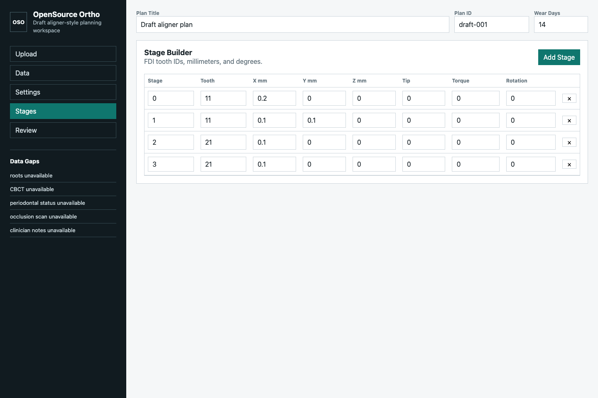
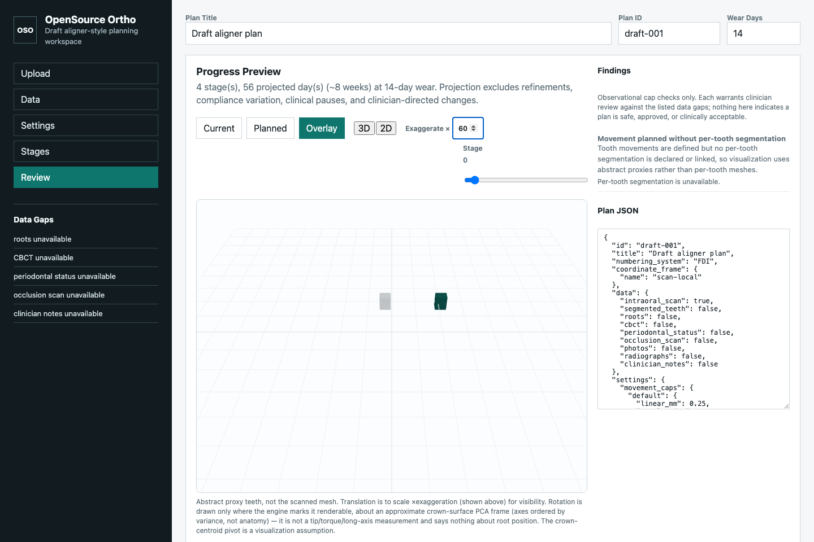

# Phase 2 UI Prototype




Browser prototype for the data-model workflow:

1. Guided six-step wizard (default) + isolated Sample Test Case demonstration
2. multi-file STL upload metadata with browser-side upload persistence
3. data availability toggles
4. movement cap controls
5. stage movement table
6. timeline projection
7. progress preview
8. scoped Plan AI chat
9. plan-shaped JSON output
10. print-export readiness and package metadata

This UI is a safety-review playground. It is not complete treatment-planning
software, does not diagnose, does not approve treatment, and does not authorize
printing, wearing, or physically applying any output. Printable files and package
metadata are informational geometry artifacts; any physical use is the user's own
responsibility and risk.

## Run it

The UI is backed by the Python engine and must be served by the dev server so
it can reach `POST /api/evaluate`:

```bash
python3 -m orthoplan.server        # or: orthoplan serve
```

Then open `http://127.0.0.1:8000`.

The app opens Your Teeth Profile at the Upload step in Guided mode by default.
Tooth Map is a separate sidebar reference page with a Back button. A light/dark switch is anchored at the
top-right of the window in every mode. The sidebar **Sample Test Case** button
opens the observed baseline/week 7 scan comparison, with an explicitly separate
simulated planning walkthrough using the redacted CBCT/root-bone fixture.
It snapshots and restores the user's working state, so it never replaces
the normal Guided or Technician flows. The same button becomes **Exit Sample Test
Case** while the sample is active, and the
Guided/Technician toggle stays available throughout so the sample can be viewed in
either mode.

## Modes

Choose **Your Teeth Profile** to open the guided workflow. Settings offers a
Technician mode for the full controls.

- **Guided** uses six steps: **Upload → Explore your teeth → Your plan → Review →
  3D preview → Print / send**. Step 2 checks tooth numbers/painted boundaries and
  timeline spacing (one week by default). Step 3 provides an editable overall
  plan brief, one goal per line, above the tooth inspection controls. Step 4
  repeats those goals beside geometric checks. Notes autosave in this browser,
  keyed by plan ID and isolated from sample notes; download them as a text file
  for a portable copy. They do not change movements, prescribe restorations or
  IPR, get sent automatically to AI, or enter movement-plan exports. The optional
  sample brief comes from a private dataset file excluded from public snapshots.
- **Technician** is the advanced workspace for records, caps, staged movement,
  clinical controls, print metadata, optimized staging, and plan JSON.

The Sample Test Case renders original baseline/week 7 surfaces and best-effort
weekly motion estimates with a shared orthographic camera. Weeks 2–6 interpolate
per-region fitted translations and quaternion rotations. `scan_motion_data.js`
validates source hashes, coordinate frames, proper registration, face masks, and
draft provenance before enabling the simulation. `scan_motion_geometry.js` builds
rigid region meshes from unchanged baseline triangles; remaining context stays
fixed. No source vertex is paired with a same-index vertex in the later scan.
`scan_history.js` chooses original or estimated frames, retaining original
endpoints when estimates fail to load. The renderer preserves the camera across
weeks and supports an estimated-vs-recorded week 7 toggle and tooth selection.

The contributor's input validation remains recorded separately from these
algorithm-generated, unreviewed estimates. Weak segmentation and match evidence
remain visible without blocking the exploratory preview. Missing/unusable regions
are held explicitly. Progress distances are scan units, not verified millimeters.
Private chipped-stone records are not discovered or loaded. Tooth identification
lives in guided step 2. See [the fitting pipeline](../docs/SCAN_HISTORY.md).

Only selecting **Simulated planning demo** loads `root-bone-fixture.json`
(redacted CBCT record metadata, accepted
fixture STL-to-CBCT registrations, safe derived anterior root centerlines,
trusted tooth axes, and an alveolar-bounds record), then runs the on-device
auto-segmenter on those scans and applies the per-tooth draft (clearly labeled as
sample-only pre-applying). That lets the 3D preview animate the scan's own crowns
moving stage by stage while the engine exposes root/bone-aware review tier state,
registration gates, trusted anatomical frames, root/bone context, and CBCT
boundary priors. The fixture is an engineering/demo artifact, not raw CBCT
segmentation or treatment approval. If segmentation fails, the movement layer
falls back to the labeled marker/arrow display. Outside the sample, movement
stays schematic/marker-based until the user reviews and applies per-tooth meshes
themselves.

The planning viewer, AI box, and upload control are relocated between workflow
hosts. Observed history has its own rendering context, which is disposed when
leaving that mode; it never reuses simulated tooth transforms.

## Plan AI

The **Plan assistant** opens from **Ask AI** and can expand into a larger
conversation workspace. Ordered prompts, replies and drafts survive navigation
and reloads via tab `sessionStorage`; New chat clears the thread and draft. The latest 16 non-error messages accompany follow-ups. Replies
render as text, including streamed updates, without interpreting model HTML.

**Settings** contains separate provider/model selectors, a session-only key,
compatible-host endpoint, and sharing consent. Done closes the dialog without
sending a request. Switching providers clears the key, endpoint, and consent.
The local helper stays offline. External models receive full plan context and
conversation only with explicit consent when sending a message or requesting an
optional AI generation review. Keys are never saved in browser storage or plans.

`chat_persistence.js` owns tab storage and interrupted-request recovery;
`chat_controller.js` owns requests, `chat_view.js` owns connection presentation,
`chat_thread.js` owns transcript updates, and `chat_settings.js` owns settings
changes. The server retains its existing output lint gate.

The assistant always works from the **full plan context** (findings, data gaps,
timeline, clinical controls, mesh metadata, and the plan snapshot); there is no
context-scope selector. For an external model the egress-consent checkbox is the
sole control over what leaves the machine.

## Engine is the single source of truth

The UI does **not** compute findings, data gaps, the timeline, or cumulative
tooth poses itself. On every edit it sends the plan-shaped JSON to
`POST /api/evaluate`, and renders exactly what `orthoplan.api.evaluate_plan`
returns - the same deterministic rules, lint-gated findings (with their data
gap and follow-up question), data-gap actions, timeline projection, and
acquisition advice, timeline projection, and `StageProgressFrame` data used
everywhere else. Cumulative movement in the canvas comes from the engine's
frames, and rotation is shown only as tabular values unless the engine receives
a trusted non-approximate anatomical frame.

If the engine is unreachable (e.g. the page was opened via `file://`), the UI
shows an "engine offline" message instead of silently falling back to a second,
divergent implementation.

Browser scan metadata is approximate; `orthoplan.io.mesh_import.inspect_mesh()`
remains the source of truth for mesh inspection, and it is the only parser for
the non-STL formats - the engine stores a canonical copy (binary STL, or XYZ for
a point cloud) that the viewer reads back, so the browser never reimplements
PLY/OBJ/3MF/glTF/FBX. Uploaded scan files are stored locally in IndexedDB so a
small upper/lower scan set survives reloads on the same browser; they are not
uploaded to a server database.

## Canonical scan fixture

`datasets/spec-07b7031938c84b1a9c98517b8bc4cdd3/` contains upper and lower whole-arch
OrthoCAD shell STLs (`initial-{upper,lower}.stl`) used to keep exact scan
rendering stable as the product evolves (and as the first tracked data
contribution). You can load them via the normal upload control to see exact
whole-arch scan rendering. **Sample Test Case** compares these baseline scans
with `progress-01-{upper,lower}.stl` in the default observed-history view. Its
separate simulation uses baseline scan fragments for synthetic stage movement.

The same folder now also contains:

- `cbct-metadata.redacted.json`: structural CBCT metadata only; no raw DICOM
  bytes, identifier values, UID values, absolute paths, or full study date.
- `root-bone-fixture.json`: accepted fixture registrations and safe derived
  anterior root/axis landmarks that exercise the root/bone-aware workflow.

Raw CBCT/DICOM remains local-only and ignored. The root/bone fixture exists so
tests and the UI can exercise registration, anatomical frames, root/bone review,
and CBCT boundary priors without checking PHI-bearing DICOM into git.

## 3D viewer

The sidebar **Tooth Map** opens **Find teeth in 3D**, an independent schematic
permanent-tooth explorer available in either workflow without uploading scans.
Enter multiple FDI numbers (for example `11 12 33 34 43 44`), select the numbered
buttons, or click teeth directly in the 3D model. Blue, red, yellow, and a custom
color picker recolor the selected teeth; FDI badges and a tooth-name list identify
the selection. Invalid numbers leave the previous selection unchanged. Clear and
Reset view controls let users start over or restore the camera.

The explorer uses schematic teeth even when patient meshes are loaded elsewhere.
It does not edit movement rows, clinical controls, or the current plan. Selection
and color remain while navigating within the page session. Keyboard-accessible
number buttons and the tooth-name list remain usable when WebGL is unavailable.

The Progress Preview renders in 3D via Three.js (`viewer3d.js`), with a 2D/3D
toggle (2D canvas is the fallback when WebGL is unavailable). Important honesty
constraints, surfaced in the on-screen caveat:

- It renders registered local STL tooth meshes when `render_meshes` links are
  available from the Python API. Otherwise it falls back to schematic proxy teeth.
  Plan JSON still does not store mesh bytes; local mesh serving is limited to
  `/api/mesh/<mesh_asset_id>` files registered in the local mesh workspace.
- Uploaded or canonical whole-arch STL scans render as an exact enamel-colored
  scan layer in Current and Overlay views. Current schematic proxy teeth are hidden
  when that exact scan layer is present, so the user is not shown two competing
  "current" anatomies.
- Reviewed per-tooth segmentation upgrades the movement layer from markers/arrows
  to real STL crown fragments moving over the scan; the viewer status and print
  checklist label which mode is active.
- Whole-arch scans are rotated from common STL dental coordinates into the viewer
  frame (`x, y, z` -> `x, z, -y`) so the occlusal plane lies on the 3D grid and
  tooth height points upward.
- Translation is exact but **exaggerated** by the on-screen ×factor so sub-mm
  movement is visible next to ~10 mm teeth.
- Rotation is drawn **only** where the engine sets `rotation_renderable`. The
  approximate crown-surface PCA frame (`tooth_frames` in the API) is metadata
  only; by itself it does not authorize rendered rotation.
- A **Tooth #** toolbar toggle overlays FDI tooth-number badges on each tooth so a
  user can see which teeth they are focusing on. It is off by default and follows
  the displayed (current or planned) tooth position.
- A **Play** toolbar button steps through the stage slider so users can inspect
  the movement path across aligner stages without manually scrubbing.
- A **Bite proximity** toggle paints a red/amber/green overlay of how close the
  upper and lower crown surfaces are (contact / near / clearance). It is GEOMETRIC
  proximity of the registered surfaces, NOT bite force or a diagnosis, and is shown
  only when the scans register as already-occluding. Backed by `POST /api/occlusion`
  (server-resolvable scans only). See [docs/occlusion-registration.md](../docs/occlusion-registration.md).
- A **Scale** toggle draws a true-scale 10 mm reference bar beside the loaded scan
  and reports its measured W×H×D extent. The scan geometry is at true scale (only
  movement is exaggerated), so the bar is honest; it needs a loaded scan with
  confirmed mm units.
- A **Registered bite** toggle moves the lower arch into the registered occlusal
  frame. It only changes separate-frame scans; arches scanned already in occlusion
  show the true bite unchanged.

Three.js (r169, MIT) is **vendored** under `ui/vendor/` and loaded via an import
map, so the app runs fully offline with no runtime calls to any external host.
To update it, replace `ui/vendor/three.module.js` and `ui/vendor/OrbitControls.js`
with a matching pinned pair.

## Auto-segmentation (experimental)

A whole-arch STL is a single shell, not per-tooth meshes, so real per-tooth
planning needs segmentation. The Technician Review side panel **Auto-Segmentation
(experimental)** proposes per-tooth regions from a loaded server-local scan via
`POST /api/segment`:

- It runs **on this machine** (scans are PHI; segmentation never calls a hosted
  API). Today the local model is a hybrid geometry proposal
  (`orthoplan/segmentation/hybrid.py`): it walks the arch, scores candidate
  boundaries from height valleys, curvature, and face-normal changes, then splits
  triangles with graph-cut-style balanced boundaries. Open3D can be installed via
  the optional `mesh-processing` extra for future mesh-processing acceleration,
  while the pure-Python path remains the default baseline. `orthoplan/segmentation/auto.py`
  is the seam where an on-device learned model (e.g. Teeth3DS / MeshSegNet) can
  be dropped in behind the same contract.
- The response is a **draft proposal**, never auto-applied: per-tooth confidence
  (separation, not certainty), advisory model-provenance findings (all pass
  `lint_finding`), and a ready-to-merge plan fragment (`mesh_assets` +
  `tooth_meshes`). Each proposed tooth mesh is written into the local mesh
  workspace and served by `/api/mesh/<id>`.
- When the request includes a plan with accepted, gate-passing registration and
  trusted CBCT-derived roots/axes (as the Sample Test Case fixture does), the
  response includes a `cbct_prior` block. These priors bias boundary placement
  and calibrate confidence; they do not replace human review or turn a proposal
  into a clinical segmentation.
- The UI lets the user correct each tooth number and include/exclude teeth, then
  **explicitly** apply the accepted set; only then does `plan.js` merge it into the
  plan. It only operates on server-local scans (the Sample Test Case / example
  scans), because uploaded bytes stay in the browser.

## Print Export

The Settings step has print-export fields for format, delivery email, dental model
material, thermoforming material, and acknowledgement. The Review step renders backend
readiness status from `print_export`. The guided **Print / send** step builds the
files in-browser via `POST /api/print-package` (which reuses `export_print_package`)
and offers a zip download plus an `.eml` draft that opens pre-attached in a mail
client. The same package is available from the CLI: `orthoplan print-package`
generates stage proxy STL files, a hash-bound manifest, optional deterministic zip
package, and optional email draft from the supplied plan data.

## Tests

Pure, DOM-free UI logic lives in `core.js` (HTML escaping, contiguous stage
reindexing, frame pose extraction, the async stale-response token guard) so it
can be unit-tested under Node with no browser or jsdom:

```bash
cd ui && node --test        # or, from the repo root: node --test 'ui/*.test.js'
```

The DOM modules (`render.js`, `plan.js`) import these helpers from `core.js`
rather than defining them inline, so the tested code is the shipped code.

A headless-browser smoke/visual-regression test (`tests/e2e/test_viewer_smoke.py`)
verifies the 3D viewer mounts a sized WebGL canvas, the acquisition panel renders,
print export readiness is visible, 2D/3D screenshot artifacts are non-empty, the 2D
canvas has non-background movement pixels, and invalid stage input reaches both the
machine-readable API rejection state and visible engine rejection state. It is skipped
unless Playwright is installed:

```bash
pip install -e ".[e2e]" && python -m playwright install chromium
pytest tests/e2e -q
```

All three suites (Python, JS, e2e) run in CI on every push and pull request.

The screenshots above are generated headlessly (no patient data) and can be
regenerated after UI changes:

```bash
pip install -e ".[e2e]" && python -m playwright install chromium
python tools/capture_screenshots.py    # writes docs/images/*.png
```

The sample paths and `USER_ONE` label come from generated `sample-dataset.js`.
Regenerate it with `python3 tools/build_dataset_catalog.py` from the repo root.
Dataset assets require the Python server, which applies the publication allowlist.

### Stable teeth view across guided steps

The same 3D viewer stays above the content for Upload, Explore your teeth,
Your plan, Review, 3D preview and Print / send once scans are loaded. Step titles,
plan goals and supporting controls sit below it. Navigation keeps camera zoom,
rotation and selection; it no longer refits the camera merely because the step
changed. Navigating from lower down the page returns the shared view below the
step rail. The viewer scrolls normally, so it does not cover notes or consume the
whole screen on smaller devices. Review and Print / send keep their checks and
handoff controls below the view without showing the tooth-editing panel.

### My Highlighted Teeth and scan tools

Settings labels the connector **AI Model Provider**; saved painting notes are in
**My Notes**. The sample's **Explore individual teeth** mode selects painted
regions in the main viewer; the painting buttons open **Edit Tooth Precision**.

Step 3 has an explicit FDI **My Highlighted Teeth** list. Save numbers, then use the viewer's
My Highlighted Teeth switch to highlight available painted crowns and their number buttons
in blue. Preferences are stored by plan ID with isolated USER_ONE storage. The
private sample brief supplies 12, 22 and 31; filtered public installations do not
receive that private default. Missing regions are listed instead of approximated.
Focus preferences do not change movement data, review status, or AI context.

The compact Highlight weeks toolbar has independent switches for blue recorded
weeks and soft-yellow estimated weeks. Unfitted/unavailable weeks stay neutral;
turning colors off retains provenance labels and the selected-week indicator.
**Compare two scans** opens the independent endpoint-fitting tool in a dialog;
both Back controls return to the same section/week. Closing the dialog keeps its
unfinished comparison in memory until the main page is reloaded. Use that tool's
Save locally action for durable comparisons. Painting and comparison links are
styled as buttons while preserving normal link behavior for modified clicks.

Plan notes also accept explicit FDI shortcuts: `@12` and `#12` add tooth 12 to
that plan's saved My Highlighted Teeth list. Tags are deduplicated and checked after a
brief typing pause or when leaving the notes field. Plain numbers, malformed
IDs and email-like tokens are ignored. The shortcut adds to existing choices
without changing the highlight switch. To remove a saved tooth, remove its note
tag and edit the My Highlighted Teeth list; deleting prose alone does not erase choices.
Storage failures remain visible, and focus changes never author movements.
