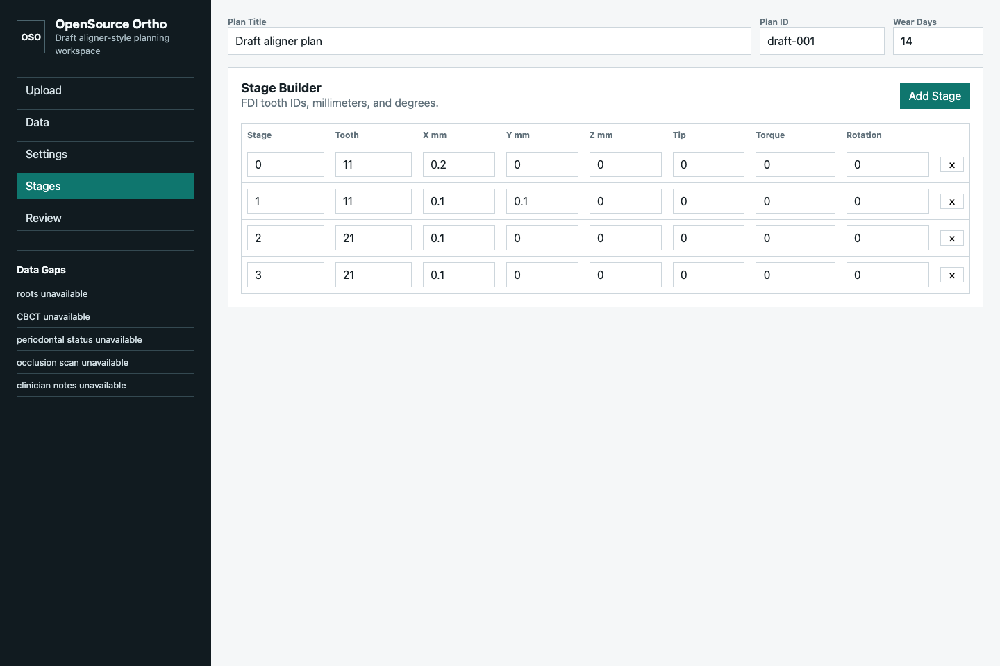
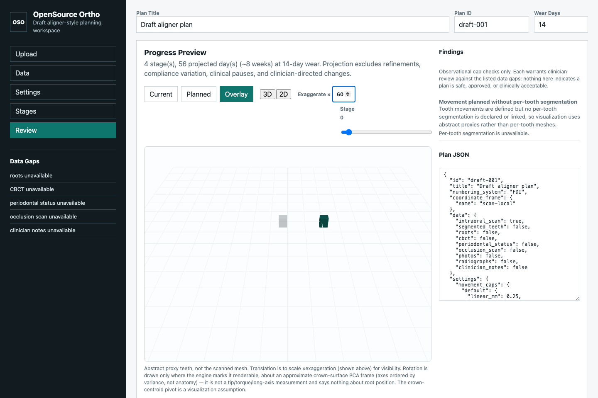

# Phase 2 UI Prototype




Browser prototype for the data-model workflow:

1. STL upload metadata
2. data availability toggles
3. movement cap controls
4. stage movement table
5. timeline projection
6. progress preview
7. plan-shaped JSON output

## Run it

The UI is backed by the Python engine and must be served by the dev server so
it can reach `POST /api/evaluate`:

```bash
python3 -m orthoplan.server        # or: orthoplan serve
```

Then open `http://127.0.0.1:8000`.

## Engine is the single source of truth

The UI does **not** compute findings, data gaps, the timeline, or cumulative
tooth poses itself. On every edit it sends the plan-shaped JSON to
`POST /api/evaluate`, and renders exactly what `orthoplan.api.evaluate_plan`
returns - the same deterministic rules, lint-gated findings (with their data
gap and clinician question), data-gap actions, timeline projection, and
`StageProgressFrame` data used everywhere else. Cumulative movement in the
canvas comes from the engine's frames, and rotation is shown only as tabular
values unless the engine receives a trusted non-approximate anatomical frame.

If the engine is unreachable (e.g. the page was opened via `file://`), the UI
shows an "engine offline" message instead of silently falling back to a second,
divergent implementation.

Browser STL metadata is approximate; `orthoplan.io.stl_import.inspect_stl()`
remains the source of truth for mesh inspection.

## 3D viewer

The Progress Preview renders in 3D via Three.js (`viewer3d.js`), with a 2D/3D
toggle (2D canvas is the fallback when WebGL is unavailable). Important honesty
constraints, surfaced in the on-screen caveat:

- It renders **schematic proxy teeth, not the scanned mesh.** We never store or
  serve mesh bytes, so the viewer cannot show real crown geometry.
- Translation is exact but **exaggerated** by the on-screen ×factor so sub-mm
  movement is visible next to ~10 mm teeth.
- Rotation is drawn **only** where the engine sets `rotation_renderable`. The
  approximate crown-surface PCA frame (`tooth_frames` in the API) is metadata
  only; by itself it does not authorize rendered rotation.

Three.js (r169, MIT) is **vendored** under `ui/vendor/` and loaded via an import
map, so the app runs fully offline with no runtime calls to any external host.
To update it, replace `ui/vendor/three.module.js` and `ui/vendor/OrbitControls.js`
with a matching pinned pair.

## Tests

Pure, DOM-free UI logic lives in `core.js` (HTML escaping, contiguous stage
reindexing, frame pose extraction, the async stale-response token guard) so it
can be unit-tested under Node with no browser or jsdom:

```bash
cd ui && node --test        # or, from the repo root: node --test 'ui/*.test.js'
```

The DOM modules (`render.js`, `plan.js`) import these helpers from `core.js`
rather than defining them inline, so the tested code is the shipped code.

A headless-browser smoke test (`tests/e2e/test_viewer_smoke.py`) verifies the
3D viewer actually mounts a sized WebGL canvas with no page errors. It is
skipped unless Playwright is installed:

```bash
pip install -e ".[e2e]" && python -m playwright install chromium
pytest tests/e2e -q
```

All three suites (Python, JS, e2e) run in CI on every push and pull request.

The screenshots above are generated headlessly (no patient data) and can be
regenerated after UI changes:

```bash
pip install -e ".[e2e]" && python -m playwright install chromium
python tools/capture_screenshots.py    # writes docs/images/*.png
```
